# DC35 Radar Badge — User Guide

Firmware 1.0.56 · board rev F (round squid) · 25 Nov 2026

The badge updates itself over Wi-Fi — see **Updates** below, including how
to stop it doing that by itself. The firmware
version it is running is shown on the Settings screen.

The badge carries a 24 GHz radar that sees people moving in front of it —
how far away, and in which direction — plus a 24-LED ring, a round screen and
three buttons. Nearly all of it is picked from one menu:

| Mode | What it's for |
| --- | --- |
| **Sneak** | A room-sized game of Red Light, Green Light with the badge as referee |
| **Duel** | Two badges, two players: the first to move loses |
| **Boss mode** | Warns you when someone walks up behind you at your desk |
| **Bling** | For wearing around: the ring follows whoever walks up to you, flying squids on the screen, or a light show shared with every badge in the room |
| **Home Assistant** | Turns the badge into a presence sensor on your home network |
| **Ring clock** | The ring becomes a clock face, set from the network |
| **Speed gun** | How fast people walk down a corridor, by radar |
| **Blue box** | The phone phreaks' 2600 Hz whistle and dialling tones |
| **Squirt** | A one-button swimmer: keep the squid off the coral |
| **Kraken Run** | A high-speed platformer through three zones, with a boss and music |
| **Squoom** | A first-person squid shooter, with real people as cyan squids |
| **Squidfall** | Falling squids, stacked into lines, with music |
| **Pet squid** | A squid to raise: feed it, play with it, keep it clean |
| **Theremin** | Play notes by moving in front of the radar |
| **Compose** | Write a 16-step tune and send it to the badges around you |
| **Morse** | Learn Morse code, then chat in it with the badges around you |
| **Fox hunt** | One badge hides, the rest find it by radio, hot and cold |
| **Spin the bottle** | The ring spins and stops on a real person the radar can see |
| **Tic-tac-toe** | Against a computer that can't lose - a nod to *WarGames* |
| **Neon trails** | Four riders, walls of light, last one moving wins |
| **Outbreak** | A con-wide infection game spread badge to badge |
| **Squoricle** | Ask it anything over the USB serial console; a tiny AI on the badge answers |
| **Contact card** | Your card as a QR code, swapped with badges held close |
| **Flashlight** | The whole ring as a light, white or red |
| **CompuNet** | The CompuNet logo, its brush-stroke C painted in by hand, and again for whoever walks up |
| **DEF CON** | The con's logo, alive: pulses along its traces, and a ring that carries its colours on |
| **Life** | Conway's Game of Life on the screen, seeded by people walking past |
| **Quest** | THE DEEP SIGNAL: a story in five chapters that runs through the whole badge, with the CTF's flags and its shared leaderboard inside it |
| **SAOs** | The SAO shapes you have collected, and your team |
| **SAO bench** | The SAO port as a bench tool: I²C scan, logic probe, signal out, UART bridge |
| **Settings** | Name, Wi-Fi setup, updates, start-up mode, factory reset |

The full Sneak rules, with the ring colours, are in the separate Sneak
rulebook.

---

## The badge

<p align="center">
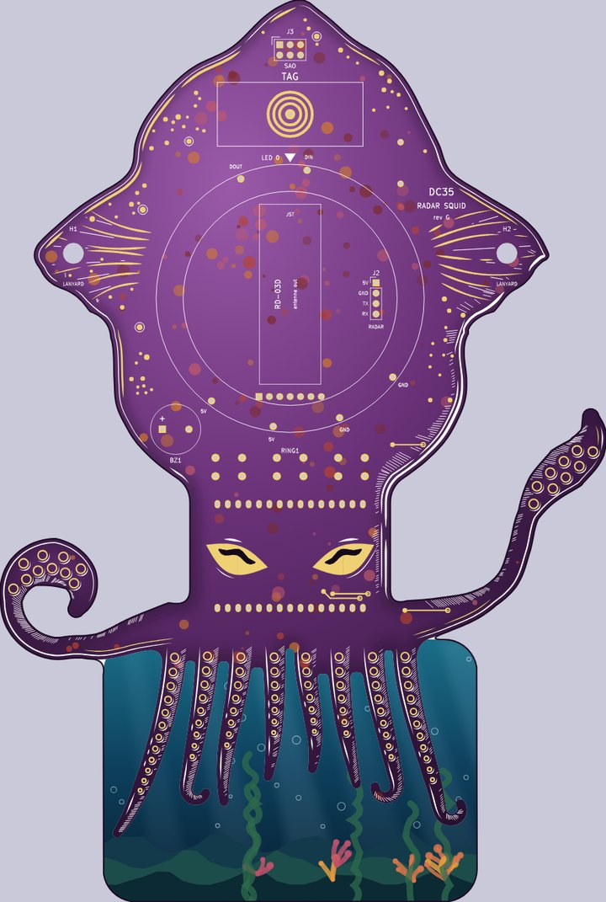
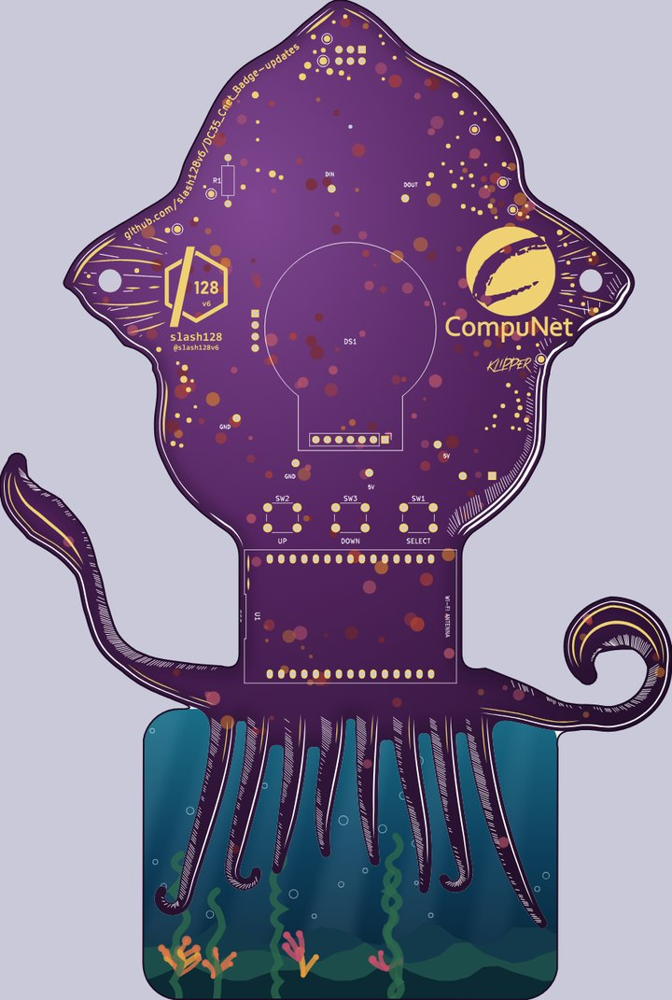
</p>

*Rev G board, front and back (renders).*

**Front — faces the room.** The radar, the LED ring around it, and a touch pad
across the mantle with the SAO port above it. The radar and the ring always
face the same way, so the ring is what the room sees. The eyes are bare
copper, so they catch the light.

**Back — faces you.** The round screen, the three buttons under it — **UP,
DOWN, SELECT** from left to right as you look at the back — and the ESP32 Dev
Module across the head. The **BOOT** button is the small one on the Dev Module
itself. The CompuNet logo is on one fin and the project's handle and URL run
up the other, both in bare copper.

**Touch pad.** The mantle is a touch pad, and it is live — look for the
bullseye and the word **TAG**. It is a second, bigger button for the three
things you do in a hurry:

| Where | A touch does |
| --- | --- |
| Sneak | TAG |
| Duel | get set / start the next round |
| Boss | clear the alert |

It never opens the menu and never changes a setting, so a knock against a
table can't launch a mode or wipe your Wi-Fi credentials.

**SAO port.** A standard 6-pin Shitty Add-On connector (3V3, GND, SDA, SCL and
two GPIOs) at the tip of the mantle, above the touch pad. Pin 1 (3V3) is the
top-left pin, pin 2 (GND) the one below it. The badge recognises the four
SAOs of its own set (circle, triangle, star and umbrella): see **SAOs**.

**Lanyard.** Two 5 mm holes, one in each fin.

**Power.** USB-C, on the Dev Module. Use a solid supply — a good charger or
power bank, not a laptop port through a long cable. Wi-Fi is the most
demanding thing the badge does and is the first thing to fail on weak power
(see Troubleshooting). There is no battery gauge on this board, so no battery
figure appears on screen.

---

## Controls

| Button | In the menu | In a mode |
| --- | --- | --- |
| **UP / DOWN** | Move the cursor. Hold to repeat. | Bling: change the highlighted setting (swapped there, to match where the buttons sit). Squirt: UP fires ink, DOWN dives. Squoom: turn left and right. Ring clock: open the alarm. Otherwise unused. |
| **SELECT**, press | Choose | Sneak: start a round, or TAG. Duel: get set. Boss: clear the alert. Bling: step through speed, brightness and pattern. Ring clock: swap the dial and the digital readout. Squirt: jet. Squoom: ink (hold to keep firing). |
| **SELECT**, hold 0.7 s | Back one level | Back to the menu — except mid-round in Sneak and mid-game in Squirt and Squoom, where SELECT is the button being hammered. BOOT works there. |
| **Touch pad** | nothing | TAG, get set, or clear an alert — see above |
| **BOOT**, press | Back one level | Back to the menu, always |
| **BOOT**, hold 0.8 s | Flip the screen | Flip the screen |

**Hold SELECT to go back** works everywhere, with one exception: **during a
Sneak round**, SELECT is the TAG button and a hard slap can easily last 0.7 s,
so holding it does nothing. Use BOOT to leave mid-round.

**Flipping the screen** turns it upside down, for when the badge is hung or
stood the other way up. The radar picture flips with it, so people still
appear on the correct side.

---

## The menu

```
Games    ─┬─ Squirt
          ├─ Kraken Run
          ├─ Squoom
          ├─ Squidfall
          ├─ Pet squid
          ├─ Theremin
          ├─ Compose
          ├─ Morse
          ├─ Fox hunt
          ├─ Spin the bottle
          ├─ Tic-tac-toe
          ├─ Neon trails
          ├─ Outbreak
          ├─ Sneak
          ├─ Duel
          └─ Back
Bling    ─┬─ Ring bling
          ├─ CompuNet
          ├─ DEF CON
          ├─ Flying squids
          ├─ Life
          ├─ Swarm
          ├─ Contact card
          ├─ Flashlight
          └─ Back
Quest
Desk     ─┬─ Ring clock
          ├─ Home Assistant
          ├─ Boss mode
          ├─ Wi-Fi watch
          ├─ Speed gun
          ├─ Blue box
          ├─ SAOs
          ├─ SAO bench
          └─ Back
Settings ─┬─ Set name
          ├─ Wi-Fi setup
          ├─ Sound: ALL
          ├─ Start: MENU
          ├─ Updates ─┬─ Check now
          │          ├─ Automatic: ON
          │          └─ Back
          ├─ Reset
          └─ Back
```

The main menu is five entries, which is exactly what the round screen shows,
so everything is in view at once. **Games** holds the games, **Desk** the
modes you stand on a table and leave running. Each list remembers where you
were, so leaving a game puts you back on it. Settings is seven rows and
scrolls; a small arrow at the edge shows when there is more above or below.
Holding SELECT goes back a level, from anywhere.

The badge starts in the menu every time it's switched on, unless you tell it
otherwise with **Settings → Start** — and except straight after saving Wi-Fi
settings, when it goes back into Home Assistant mode by itself - and greets
its first connection with the sound of a dial-up modem.

The ring shows a single dim dot creeping round while the menu is up.

---

## Sneak

One badge stands on a table facing the room. Players start at a line up to
6 m away and try to reach it and TAG it — SELECT, or a slap on the touch pad.
Most of the time the badge is *blind* and players can move. Then it flashes
amber, turns red and *looks*: anyone the radar sees moving is caught, the ring
points a white light at them, and they walk back to the start. Reach the badge
and TAG it — even while it's looking — to win the round.

| Phase | Ring | Length |
| --- | --- | --- |
| Ready | white, breathing | until SELECT |
| Blind | green, with a chasing spot | 2.5–6 s, random |
| Turning | fast amber flashes | 0.9 s |
| Look | solid red | 2.5–5 s, random |
| Caught | pulsing red, white pointers | 3 s, then Blind |
| Tagged | rainbow | 5 s, then Ready |

Setting up: stand the badge **upright and level** (the radar is widest side to
side), with nothing in front of it, and keep players in front — the radar sees
60° either side of centre and can't catch anyone walking round the side.

See the Sneak rulebook for the complete rules.

---

## Duel

**Two badges.** Two players stand a few metres apart, each **pointing their
badge at the other player**. The badges agree a countdown between themselves,
both rings go blue, and then nobody may move. The first to move loses.

Each badge judges the player in front of it, never its own wearer — the badge
has no way to feel itself move, only to watch the person opposite. So the call
is always made by your opponent's equipment, and nobody has to be taken at
their word. A badge never declares itself the loser.

**Playing a round**

1. Both players pick **Games → Duel**. Each screen finds the other badge and shows
   `ready` with the opponent's id.
2. Point your badge at the other player, at about chest height, and press
   **SELECT** (or touch the pad) when you are set. Press again to un-set if
   you mis-pressed.
3. When both are set the countdown starts: the rings flash amber, faster as
   the moment approaches. **Moving now is a false start and loses the round.**
   How long it lasts is random, 2–5 s, so it can't be timed.
4. The rings go solid blue: **HOLD**. Stand still. Breathing and a little sway
   are fine. A move is about 20 cm from where you stood, or any brisk
   movement at all: the radar also feels speed, so a step counts the moment
   it starts, and stepping then freezing still counts.
5. The first badge to see its opponent move says so. The winner's ring goes
   rainbow, the loser's flashes red, and the screens show how far into the
   round it happened. After 6 s both go back to `ready` for the next one;
   SELECT or a touch skips the wait. Both players then set again.

| Ring | Meaning |
| --- | --- |
| dim, one dot creeping | no other badge in range |
| amber, breathing | opponent found — press SELECT when set |
| amber flashes, speeding up | countdown; don't move |
| solid blue | HOLD — the round is live |

**Teams.** Once either badge has had an SAO plugged in, the `ready` screen
shows both teams, such as `STAR vs CIRCLE` (see **SAOs**). It is for the
banter: a team doesn't change who wins.
| rainbow | you won |
| red flashes | you lost |

**Notes**

- **Standing perfectly still makes you vanish from the radar**, which is
  exactly what the game asks for — disappearing is not losing.
- Stepping out of the radar's view and back doesn't buy you a fresh start; the
  badge keeps the position it first anchored on.
- The badges talk over ESP-NOW, with a shared key that keeps stray traffic
  out. They do **not** need Wi-Fi or a network — just both being in Duel mode
  within radio range.
- **Each badge picks one opponent**, and the round starts only once two have
  picked each other. The screen shows `finding` and the other badge's name,
  then `vs` and the name once you're paired — check it's who you meant. From
  then on the badge listens to that opponent alone, so other badges nearby
  can't interfere.
- **Duel and Home Assistant can't run at the same time.** The radio does one
  or the other, so entering Duel takes it and leaving gives it back.
- With only one badge in range the screen says `no other badge yet` and waits;
  when every badge in range is already paired it says `the others are busy`.
- **Keep the badges still.** A badge that turns makes the person in front of
  it look as if they moved — at 3 m, a 4° turn is the whole 20 cm. Stand the
  badges on something, or hold them flat against your chest.
- **Nobody between the players.** Each badge judges the nearest person in
  front of it, so someone walking between you becomes the one it's watching.
- Badges on 1.0.23 or older don't see 1.0.24 badges in Duel; the radio
  messages changed. They update themselves.

See the [Duel rulebook](duel_rulebook.html) for the complete rules.

---

## Boss mode

Stand the badge on your desk facing the room **behind** you. It ignores
everything within 0.9 m — that's you — and watches for someone walking up.

It warns you when a person within 3.5 m closes at least 30 cm in under a
second while heading towards you. Someone walking past, or pacing on the far
side of the room, doesn't set it off.

- **Screen:** a flashing red frame and `INCOMING`, with how far away they are
  and at what angle. If they stop, it says `last seen` and `standing still?`
  — the radar can lose sight of a person who holds still.
- **Ring:** dim cyan while watching; a dim, slow amber breath on an alert. The
  ring faces the person walking up, so it deliberately stays subtle. The loud
  alert is the screen, which only you can see.
- **SELECT, or a touch on the pad,** clears the alert. The alert stays until
  you do. Touching is the quiet way — no reaching round the back of the badge
  while someone is standing over you.
- **Hold SELECT** during an alert clears it first; hold again to leave.

---

## Bling mode

**Bling → Ring bling.** For wearing around. The screen dims and the ring's power is capped to stretch
the supply.

The ring **follows people**. Whoever the radar can see lights the part of the
ring facing them — straight ahead is the top of the ring, and the further to
one side they stand, the further round that side the light goes, almost to the
bottom at the edge of what the radar sees. Up close the glow is warm, bright
and wide; across the room it is a single cool, dim point. It moves as they do. With nobody about it drifts through a rainbow
instead, so an empty corridor still looks alive.

| Button | Does |
| --- | --- |
| **SELECT** | Step through the three rows — **SPEED**, **BRIGHT**, **PATTERN**. The highlighted row is the one UP/DOWN changes |
| **UP / DOWN** | **Swapped in this mode to match where the buttons sit:** UP, the left button, moves the bar left (less); DOWN, the right button, moves it right (more). The levels stop at the ends; **PATTERN** wraps round, because it is a list rather than a scale |
| **Hold SELECT** | Back to the menu |

**PATTERN** picks one of eight. **FOLLOW** is the behaviour above and the only
one that uses the radar; the other seven are the DC31 badge's ring patterns,
brought over to this one.

| Pattern | What the ring does |
| --- | --- |
| **FOLLOW** | Points at whoever the radar sees. Falls back to RAINBOW with nobody about |
| **RAINBOW** | The whole ring drifting through the spectrum, with a slow breath on top |
| **GLITTER** | The rainbow, with white sparks landing at random |
| **CONFETTI** | Coloured speckles that appear and fade, mostly dark between them |
| **COMET** | One dot running round the ring with a fading tail behind it |
| **PULSE** | Party-palette stripes breathing in and out together |
| **JUGGLE** | Eight dots at eight slightly different speeds, weaving in and out of step |
| **PALETTE** | Smooth colour washes, changing scheme every eight seconds |

FOLLOW already falls back to the rainbow when no one is there, so choose RAINBOW
only if you want it *even with people around*.

**SPEED and BRIGHT work on all eight.** SPEED is a quarter speed at level 1 and
four times at level 5, so a pattern you find frantic is one press away from
calm. BRIGHT is the same five steps throughout, and the power cap still has the
last word — the ring stops getting brighter rather than browning the board out.

All three settings are remembered when you switch off. The levels start at 3 of
5 and the pattern starts on FOLLOW.

---

## CompuNet


**Bling → CompuNet.** The CompuNet logo: the blue disc and its white
brush-stroke C. The C paints itself in the way it was written, one sweep from
the top right round to the tip, with a warm glint at the bristles. Then it
holds, and now and then light runs along the stroke again. It signs for
visitors: when someone walks up, it paints the C again for them, and the
glints come quicker while they stay. The ring follows the brush round in
CompuNet blue and white.

**SELECT** paints it again; hold SELECT to go back.

## DEF CON


**Bling → DEF CON.** The con's logo, alive on the screen. Light runs outward
along the circuit traces from the middle, like signals on a board, the heart
of it beats, a scanline rolls down and now and then the picture tears
sideways like an old monitor's. It wakes up for people: as someone comes
closer the pulses quicken, the heart beats faster and the tears come more
often. The ring carries the art on past the glass - each LED in the colour of
the traces on its side, lighting as each pulse reaches the edge.

**SELECT** sets off a burst of glitch; hold SELECT to go back. Until the
DEF CON 35 art is out, it's last year's DC34 logo; the new one will come in an
update.

## Flying squids

**Bling → Flying squids.** A screen saver for the round screen: a flock of
squids flies across it on flapping fins, mantle first, arms streaming behind,
with the odd pearl drifting along among them over a twinkling night sea.

It watches the room. When somebody comes within about a metre and a half the
flock startles and flies faster, and the ring — facing them — lights warm
toward each person the radar sees, over a comet that circles at the flock's
pace.

| Button | Does |
| --- | --- |
| **UP / DOWN** | A bigger or smaller flock, one to twelve |
| **SELECT** | Colours: PINK, RAINBOW, TEAM (your SAO team's) and GOLD |
| **Hold SELECT** | Back |

## Life

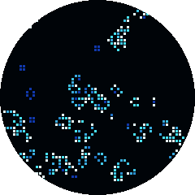

**Bling → Life.** Conway's Game of Life, as something to wear. Its glider -
five cells that walk diagonally across the grid for ever - is the hacker
emblem. A live cell with two or three live neighbours lives on, an empty one
with exactly three comes alive, and everything else dies; new cells are
bright and cool to blue as they age. The radar joins in: whenever someone new
walks up, a glider sets off from their side of the screen, so a busy corridor
keeps the board alive. When it dies out or settles down, it starts again.

| Button | Does |
| --- | --- |
| **UP** | Launch a glider |
| **SELECT** | Start again from a random soup |
| **Hold SELECT** | Back to the menu |

## Swarm

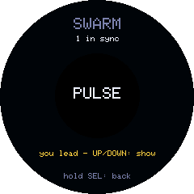

**Bling → Swarm.** Every badge in the room, one light show. Badges in Swarm
share a clock over the badge-to-badge radio, so their rings pulse, spin and
sparkle together. One badge leads: it sets the clock and picks the show, and
the rest follow, passing the clock on to badges further away.

| Button | Does |
| --- | --- |
| **SELECT** | Take the lead |
| **UP / DOWN** | The show — on the leading badge |
| **Hold SELECT** | Back |

| Show | What the room sees |
| --- | --- |
| **PULSE** | Every ring flashes on the beat, changing colour every eight |
| **WAVE** | The beat rolls outward from the leader, badge by badge, by how far each one is from it |
| **RAINBOW** | A rainbow turning on every ring at once |
| **SPARKLE** | The same sparkle on every badge at the same moment |
| **SPIN** | A comet chasing round every ring in step |

The screen shows the same show in the middle, how many badges are in sync,
and who leads. If the leader leaves, the swarm settles on another by itself.
Swarm also carries **Ink outbreak**.

## Contact card

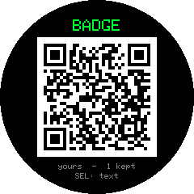

**Bling → Contact card.** Your contact card as a QR code, for anyone with a
phone camera — and a way to swap cards with another badge by holding the two
together.

The card is one line of up to 60 characters that you choose: a link, a
handle, an email, whatever you'd want a stranger to have. Set it either way:

- on the serial console (see **CTF → The serial console**): `CARD <text>`,
  for example `CARD https://example.com/me`. `CARD` on its own shows it and
  `CARD CLEAR` empties it;
- on the **Wi-Fi setup** page, in the **Contact card** box.

| Button | Does |
| --- | --- |
| **UP / DOWN** | Your card, then each card you've been given, newest first |
| **SELECT** | The QR code, or the card as text |
| **Hold SELECT** | Back |

**Swapping.** Both owners open **Contact card**, then hold the two badges
together for a second or two. Each badge keeps the other's card, chimes and
flashes the ring green, and shows it straight away. A badge in the mode
further off counts as nearby but isn't swapped with — the screen says *hold
the badges together* — so nobody collects your card from across the room.
Nothing is sent in any other mode, and only what you typed into your card
goes out, with your badge name.

Cards you've been given show as QR codes too, so a phone can pick up a
friend's card from your badge later. The badge keeps the last 20. Over serial,
`CARDS` lists them and `CARDS CLEAR` forgets them all; **Settings → Reset**
clears them along with your own card.

## Flashlight

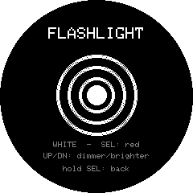

**Bling → Flashlight.** The whole ring as a light, for dark parties, dropped
keys and menus in dim bars. The ring is on the front, so turn the screen
towards you and point the badge.

| Button | Does |
| --- | --- |
| **UP / DOWN** | Dimmer / brighter, three steps |
| **SELECT** | White or red. Red keeps your eyes used to the dark, and doesn't dazzle whoever you're talking to |
| **Hold SELECT** | Back |

The brightest step is the most the ring is allowed to draw, so it is safe on
any supply that runs the badge.

## Home Assistant mode

The badge joins your Wi-Fi, connects to your MQTT broker and announces itself
to Home Assistant. Nothing needs configuring on the Home Assistant side.

### You'll need

- Home Assistant with the **MQTT integration** and a broker (for example the
  Mosquitto add-on), and the broker's IP address, username and password.
- A **2.4 GHz** Wi-Fi network. The badge can't see 5 GHz.
- A phone or laptop to fill in the setup page.

### First-time setup

1. Pick **Desk → Home Assistant** from the menu. The screen says **Wi-Fi setup** and
   shows a network name like `badge_f9d108-setup` and the address
   `192.168.4.1`.
2. On your phone, join that network. It's open — no password. Your phone may
   warn that it has no internet; stay connected.
3. Open `http://192.168.4.1` in a browser.
4. Choose your Wi-Fi network from the list. Not there? Press **Rescan** (the
   setup network drops for a few seconds while it scans; rejoin if your phone
   wanders off). For a hidden network, type its name in the box below.
5. Enter the Wi-Fi password, the MQTT broker's IP address, port (usually
   `1883`), and the MQTT username and password.
6. Press **Save and restart**. The badge restarts straight back into Home
   Assistant mode and connects.

The screen shows `Wi-Fi...`, then `MQTT...`, then `online`. The device appears
in Home Assistant under **Settings → Devices & services → MQTT**, named after
the badge.

### What it reports

| Entity | Meaning |
| --- | --- |
| **Occupancy** | Someone is in the room |
| **People** | How many people the radar is tracking right now, 0–3 |
| **Distance** | Nearest person, in metres |
| **Bearing** | Nearest person's angle; negative is left, positive is right |
| **Wi-Fi signal** | Diagnostic: the badge's signal strength in dBm |

### What Home Assistant can do to it

The badge answers back. Four more entities appear on the device, for
dashboards and automations:

| Entity | What it does |
| --- | --- |
| **Ring** | A light. Turn it on and the ring is yours: any colour and brightness, with the effects *Solid*, *Breathe* and *Spin*. Turn it off and the ring goes back to showing presence. |
| **Message** | Text, up to 60 characters. The badge chimes and shows it full screen until you press UP or DOWN, or for a minute. |
| **Chime** | A button. The badge chimes and flashes white: handy for finding it. |
| **Ring follows** | A switch, on to start with. One bright LED points at the nearest person, so you can see what the sensor sees while you place it. Turn it off for a bedroom. |

A build light that goes red when CI fails, the washer finishing, someone at
the door: anything Home Assistant knows, the badge can show. They work while
the badge is in Home Assistant mode, which is when it is on your network.
Messages are plain ASCII; anything else shows as `?`.

It publishes whenever occupancy or the head count changes, and every 15 s
regardless. When the badge is switched off or leaves the mode, Home Assistant
shows it as unavailable within a minute or so.

**Occupancy turns on fast and off slowly.** The radar only sees movement, so a
person sitting still at a desk keeps disappearing from it for a few seconds at
a time. Occupancy therefore switches on at the first sighting and only
switches off after **60 seconds** with nobody seen at all. Build automations
around that — don't expect the lights to go off the instant someone leaves.

### Where to put it

- **Facing the room,** upright, with nothing in front of the radar.
- **On a good power supply.** Weak power shows up as Wi-Fi that won't connect.
- Wi-Fi on this board is strong, but the signal reading is still worth a
  look if anything misbehaves. Around −70 dBm or better is comfortable.

### The screen and ring

| Screen | Ring | Meaning |
| --- | --- | --- |
| `Wi-Fi...` | off | Joining Wi-Fi. The ring stays dark to keep the radio's power clean. |
| `MQTT...` | amber, breathing | On Wi-Fi, reaching the broker |
| `online` | cyan, breathing | Connected, room occupied |
| `online` | very dim green | Connected, room empty |
| `failed` | dim red | Couldn't connect — `check credentials` |
| `NOT PUBLISHING` | — | No radar found, so it refuses to send made-up data; Home Assistant shows it offline |

### When it can't connect

- **Wi-Fi never connected** (four tries, 45 s each) → back to the setup page,
  which says `Wi-Fi did not connect`.
- **The broker rejected the username or password** → back to the setup page.
- **The broker couldn't be reached for 2 minutes** → back to the setup page.
- **Once it has been online** with the saved settings, it never falls back to
  the setup page again — a later drop just means it keeps retrying.

To change network or broker later, use **Settings → Wi-Fi setup**.

---

## Ring clock

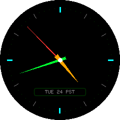

Both the ring and the screen become a watch dial.

On the **ring**: an **amber hour hand**, a **green minute hand** and a **dim
blue second hand** sweeping round, with faint marks at 12, 3, 6 and 9 o'clock.
Twelve is the top of the ring — the same direction everything else on this
badge points.

On the **screen**: a proper dial, with minute dots, thicker marks at the
quarters, the same three hands and a date window at six o'clock showing the
weekday, the date and the time zone. **Press SELECT** to swap it for a digital
readout — big time, date, and how long ago the clock last synced — and SELECT
again to come back. Which one you left it on is remembered.

| Button | Does |
| --- | --- |
| **SELECT** | Swap the screen between the dial and the digital readout |
| **UP or DOWN** | Open the alarm |
| **Hold SELECT** | Back to the menu |

On the ring the hands sit *between* LEDs as well as on them, lighting two in
proportion, so the minute hand reads to the minute rather than in the
2.5-minute steps 24 LEDs would otherwise allow. The ring is dimmer here than in
any other mode — this is the one that sits on a desk for hours, possibly in the
dark.

**The badge has no battery-backed clock, so it takes the time from the
network** — but it never switches Wi-Fi on to do it. It takes the time whenever
the radio happens to be up, which means every ten minutes or so while it is
checking for updates, and continuously in Home Assistant mode. It asks the moment the radio connects, and keeps it on a few seconds longer if
the answer has not arrived yet — so on the defaults the clock sets itself within
about ten seconds of being switched on.

While it has no time the ring shows **one dot circling** rather than a pair of
stopped hands, because stopped hands look like a fault and this is not one —
and the dial on screen stays empty with `NOT SET` in its date window. If it
says that, either set Wi-Fi up
(**Settings → Wi-Fi setup**), or — if you have turned automatic updates off — use
**Settings → Updates → Check now** to put the radio on long enough to catch the time.

**Set your time zone on the setup page**, the same page as Wi-Fi: a list of
common zones, and a box for a POSIX `TZ` string if yours is not on it. Until you
do, the badge shows **UTC** and says so on screen, rather than guessing a zone
and being confidently hours wrong. The zones on the list carry daylight-saving
rules, so the badge changes with the clocks by itself.

The time survives a restart, an over-the-air update included, because the chip
keeps counting through it. It is a plain crystal with no temperature
compensation though, so a badge kept off the network for a day is minutes out
rather than seconds. The screen says how long ago it last synced, and says it in
amber once that is over twelve hours.

Set **Settings → Start** to *CLOCK* and the badge comes up as a clock after a
power cut, which is the point of a desk clock.

### Alarm

Press **UP or DOWN** on the clock to open the alarm. On that screen **UP and
DOWN** move the time five minutes a press, thirty once you hold the button for
a second; **SELECT** turns it on or off; and **holding SELECT** (or BOOT) goes
back to the clock and saves it. It can also be set on the setup page, next to
the time zone. While it is on, the dial shows an amber dot at the hour it will
ring, the way an alarm clock does, and the digital readout says
`alarm 7:30 AM`.

**It rings in any mode,** not just on the clock: an alarm that only works on
one screen is one you set and then miss because the badge was in Bling. It
beeps, the whole ring flashes, and the screen says ALARM. Whatever you were
doing waits underneath and carries on afterwards — though a game of
Squirt or Red Light, Green Light will have been paused, and a Duel's
opponent will have given up on you.

| Button | Does |
| --- | --- |
| **SELECT** or the touch pad | Snooze for 9 minutes |
| **BOOT** | Turn it off |

Nobody there: it gives up after two minutes. With **Settings → Sound** set to *OFF*,
the ring and the screen still flash but the piezo stays quiet, so a mute set
for a talk stays a mute.

**It needs the time,** so a badge that has not been online since it was
switched on cannot ring — the alarm screen says so when that is the case.

---

## Wi-Fi watch

**Desk → Wi-Fi watch.** The badge listens to the Wi-Fi around it — every
2.4 GHz channel in turn, a sweep every few seconds — and raises the alarm on
the attacks a hacker con actually sees. It only ever listens: it joins nothing
and transmits nothing, so it can't disturb anyone's network.

It watches for three things:

- **Deauth flood** — a burst of "disconnect" frames on one channel, seen twice
  within ten seconds. Knocking people off a network is how an attacker makes
  their devices reconnect, to a copy of the network or so the reconnection can
  be captured. A single burst on its own is ignored: access points kick
  clients off now and then, and repeat themselves when they do.
- **Twin** — one network name broadcast both **open** and **protected**. The
  classic "evil twin" copies a real network's name without its password. The
  badge knows no network names in advance; it compares what it hears with
  itself.
- **Many names** — one access point announcing four or more network names.
  Real access points give each network its own address; a "Karma" rogue
  answers to whatever name a phone asks for, all from one radio.
- **New AP**, once you **pin your own network** — that name from an access
  point that wasn't there when you pinned it, or one of yours changing its
  security. This catches the twin the check above can't: one that copied the
  password too, which at a con is often printed on the wall.

**Pinning your network.** Somewhere you trust, with your network in range: on
the **NETWORKS** page press **SELECT**, move to your network with **UP/DOWN**,
and press **SELECT** again. The badge remembers every access point it hears
broadcasting that name. The WATCH page then says `guarding` and the name, and
in the network list your access points show in cyan and any stranger using
the name in red. Choose the pinned network again to unpin it (after adding an
access point at home, say), then pin it once more. One network at a time;
**Reset** clears it.

| Button | Does |
| --- | --- |
| **UP / DOWN** | Change page: **WATCH** (live alerts in red, marked `NOW`; after 30 quiet seconds, `QUIET` with the last alert under `EARLIER`), **NETWORKS** (what is nearby, strongest first — signal, channel, security, name; open ones in amber), **CHANNELS** (how busy each channel is) |
| **SELECT** | On NETWORKS: pick a network to pin (then UP/DOWN to move, SELECT to pin, hold SELECT to cancel). Elsewhere: next page |
| **Hold SELECT** | Back to the menu |

**The ring:** quiet, one dim green dot stepping round with the channel; on an
alert, the whole ring breathes red until things have been quiet for 30
seconds, and the piezo sounds once for each new alert.

**The radio is its own** while it runs, as in Duel and the CTF: no update
checks and no Home Assistant. Leaving switches the radio off. The ESP32 only
hears 2.4 GHz, so 5 GHz networks don't appear.

**What it can't tell you:** an alert means the pattern is on the air, not who
is behind it or that you are the target. Some venues' own access points flood
deauths at networks they consider rogue, and a phone hotspot can share a name
with a real network by accident. It is a smoke alarm, not a verdict.

---

## Speed gun

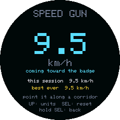

**Desk → Speed gun.** How fast people walk, by radar. Stand the badge up at
one end of a corridor or a queue, pointing along it. The radar measures each
person's speed by Doppler and the screen shows it, big, in cyan coming toward
the badge and in orange going away, with the fastest of the session and the
fastest the badge has ever clocked. A new record gets a fanfare.

| Button | Does |
| --- | --- |
| **UP** | km/h, mph or m/s |
| **SELECT** | Start the session's fastest again |
| **Hold SELECT** | Back to the menu |

Doppler only measures speed along the line of sight: someone walking straight
at the badge reads their full pace, someone crossing in front of it reads
almost nothing - hence the corridor. Over USB serial, `SPEED` gives the
readings and `SPEED CLEAR` forgets the all-time best.

## Blue box

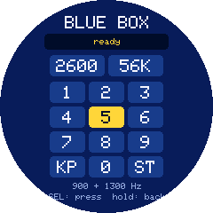

**Desk → Blue box.** The phone phreaks' tone box, on the piezo. In the 1960s
and 70s the long-distance network signalled down the voice line itself: a
**2600 Hz** tone told a trunk it was free - the toy whistle in a box of
Cap'n Crunch made exactly that note - and pairs of tones dialled the next
exchange. A blue box made those tones. (It's also why the hacker quarterly is
called *2600*.) Networks moved their signalling elsewhere decades ago, so
today it's a museum piece that beeps.

**UP** and **DOWN** move round the keys - 2600, the digits, KP to start a
number and ST to end it - and **SELECT** sounds one, with its two frequencies
shown and lit on the ring. A real digit is two tones at once; one piezo can
only make one, so they're played alternately, fast. Over USB serial,
`BLUEBOX 2600 KP 1 2 1 ST` plays a whole sequence.

**56K**, beside 2600, is the sound of the next era: a dial-up modem getting
online - the dial tone, the number, the answer tone, the screech and the hiss.
The badge plays it once by itself, too: the first time it connects after you
save its Wi-Fi settings.

## SAOs

**Desk → SAOs.** The badge recognises the four SAOs of its set by what is
wired to their spare pins, and remembers every shape it has had plugged in. This screen shows
the four: a dim outline for one you haven't had yet, filled in its colour once
you have, and circled while it is plugged in. The ring shows the same thing, a
quarter of the ring per shape, with the plugged-in one pulsing.

| Shape | Creature | Colour |
| --- | --- | --- |
| Circle | a pearl | cyan |
| Triangle | a shark fin | red |
| Star | a sea star | amber |
| Umbrella | a jellyfish | magenta |

**Its light.** Each SAO has a colour LED, and the badge drives it: the shape
glows in its colour, blinks three times when you plug it in and three times
white whenever you capture a CTF flag, and breathes once you hold the
**SAO set** flag. There's one more trick for later, and it keeps an eye on
**THE DEEP SIGNAL** too. It's dimmer at night. Quest mode and the SAO bench
borrow its pins while they're open, so a Circle's or Umbrella's light holds
still there (a Triangle or Star carries on). On a badge from outside the set
it stays dark. Over USB serial, `SAOLED BLINK` blinks it.

**Your team** is the shape of the last SAO you plugged in, and stays when you
unplug it. Every kit has all four, so pick a favourite and plug it in last. Duel shows both players'
teams, and the CTF leaderboard marks each badge's team and adds the teams up.

**The collection** counts to four. Having had all four plugged in, one at a
time, captures the CTF's **SAO set** flag. The four SAOs are also how you play
the CTF's text adventure, **The Deep**.

The badge checks the socket every two seconds, and twice a second on this
screen. It never does while the CTF is open, which uses those pins itself. An
SAO from outside the set reads as `an SAO this badge doesn't know`, and is
harmless. Over USB serial, `SAO` names what is plugged in, the collection and
the team.

---

## SAO bench

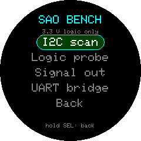

**Desk → SAO bench.** The SAO port as a small bench tool, for hacking on an SAO
or anything else that runs at 3.3 V. Pick a tool with UP, DOWN and SELECT;
hold SELECT to go back to the list.

**3.3 V logic only.** Nothing here level-shifts: 5 V into these pins will
damage the badge. The header's pins are 1 3V3, 2 GND, 3 SDA, 4 SCL, 5 and 6
the two GPIOs.

| Tool | What it does |
| --- | --- |
| **I2C scan** | Lists every address that answers on SDA/SCL, with a guess at the common ones (OLED, EEPROM, IMU, BME280…). SELECT scans again. If SDA or SCL is held low it says so rather than hang. |
| **Logic probe** | The level on pins 5, 6, SDA and SCL, and the frequency on pins 5 and 6, averaged over a second, up to 300 kHz. SELECT changes the pull resistor: down, up or none. |
| **Signal out** | On pin 5. SELECT steps through **off**, **square** (1 Hz to 100 kHz), **sine** (200 Hz to 100 kHz, from the chip's DAC) and **DC** (0 to 3.3 V). UP and DOWN change the frequency or the voltage. |
| **UART bridge** | Joins the USB serial console to the SAO pins: the badge transmits on pin 5 and receives on pin 6. UP and DOWN set the baud rate, 9600 to 230400; SELECT starts and stops it. While it runs, what you type goes to the device rather than to the badge's own commands, and the screen shows the byte counts and the latest text received. |

The pins go back to plain inputs whenever a tool closes, and the badge doesn't
check which SAO is plugged in while the bench is open.

---

## Squirt

The squid swims by itself. You keep it off the coral.

| Button | Does |
| --- | --- |
| **SELECT** | **Jet** — a kick upward, the moment you press. The squid sinks when left alone |
| **DOWN** | **Dive** — a kick downward, for the gap that is below you |
| **UP** | **Ink** — a shot straight ahead for each press, as many at once as you have ink. Pops a jellyfish |
| **BOOT** | Back to the menu. Holding SELECT only works on the title and game-over screens: mid-game SELECT is the button you are hammering, and a long press there must not end the run |

Coral grows up from the sand and hangs down from above, with a gap to swim
through. **Jellyfish** drift in the open water between: dodge them or ink them.
**Pearls** are worth points and give back one shot of ink. You have **three
lives**, a moment of flashing grace after each hit, and **a life back every
300 points** — up to three; one that comes due while you are full is not
saved up. The floor and the
surface are walls, not hazards. It gets faster, and the gaps narrower, the
further you go — and it is the same course every run, so a best score means
something. The best is kept when the badge is switched off.

**A crowd is worth points.** Every person the radar can see in front of the
badge multiplies the bonus for pearls and jellyfish — x2 with one person
watching, up to x4 with three.

**The ring is the scoreboard**, so the screen does not need one: three pink
pairs at the top are your lives, three blue pairs at the bottom are your ink.
It flashes red on a hit and gold on a pearl. The same pips are on the screen
under the score, for when the ring is facing away from you.

**Music.** A bouncy tune plays while you swim, quickening as the course
speeds up. **Settings → Sound** set to *EFFECTS* keeps the effects without it.

### Screen speed

The game needs the whole screen redrawn every frame, and how fast that can be
done depends on how fast the badge talks to its screen. Out of the box that is
40 MHz, which gives the game its full 30 frames a second; the title screen
shows the speed. (Before firmware 1.0.22 it was 20 MHz, about 20 frames a
second.)

Whether a particular badge's wiring can carry another speed is something only
that badge can answer, so you try it and look:

1. On the game's title screen, press **UP**. The badge restarts and comes
   straight back to the title at the next speed (80, then 20, then 40),
   **for that one boot only**.
2. If the picture is clean — no speckle, no torn or shifted rows — press
   **DOWN** to keep it. It is used from then on, by every mode.
3. If the picture is bad, or blank, switch the badge off and on. Nothing was
   saved, so it is back as it was.

If the screen is ever speckled or garbled in every mode, **hold UP and DOWN
together while switching the badge on**. That sets the safe 20 MHz, which every
badge runs, without needing to read the screen.

The badge does not check for updates while the game is open.

## Kraken Run

**Games → Kraken Run.** A high-speed platformer, starring a squid. Run, roll
and jet through three zones — **Coral Reef**, **Kelp Forest** and **the
Trench** — collecting pearls, bouncing off coral springs and curling into a
ball to bowl over crabs, jellyfish and rival ink-squids. At the bottom of the
Trench waits the Kraken.

| Button | Does |
| --- | --- |
| **DOWN** (held) | Run right. DOWN is the right-hand button |
| **UP** (held) | Run left |
| **SELECT** | Jump — hold it for a higher one. A jump curls you into a ball, and a ball bowls over anything it lands on |
| **Touch the top** | Ink jet: a burst of speed, rolled up and unstoppable, every second and a half |
| **BOOT** | Back to the menu. Holding SELECT only works on the title and game-over screens |

**Hills are momentum.** Run down one and you carry the speed up the next and
off its lip into the air; launch ramps throw you over trenches. Too slow to
climb something? Back up for a run at it, or ink-jet.

**Pearls are your shield.** Hit something while you hold pearls and they
scatter — grab what you can before they sink. Hit with none and it's a life.
Three lives, and a checkpoint buoy halfway through each zone; sea urchins and
the drop off a ledge are the things to watch.

**Ink-squids** hover, drift toward you and spit ink. One swells and darkens
just before it fires; the ink hurts unless you're ink-jetting through it.
Bowl them over like anything else. Each zone's tally pays for
pearls and for speed, and — as in Squirt — **every person the radar sees
watching multiplies it**, up to four times.

**The Kraken** lurks behind the far cliff of its arena. It raises a tentacle
over wherever you stand — a shadow on the floor says where — and slams it
down, so keep moving. After a few slams it lowers its great head into the
arena to glare at you: that's the opening. Jump and come down on it in a ball.
Six hits; it gets quicker as it hurts, and from halfway it spits ink too.

The ring is the speedometer, green to yellow to red, and flashes gold for a
pearl and red for a hit; during the fight it counts the Kraken's health. The
squid wears your SAO team's colour. Each zone has its own tune, and the
Kraken has its own — all written for the badge. The best score is kept.

## Squoom

A first-person shooter, with squids. You hold the middle of an underwater hall
and they swim in from every side; you turn and ink them before they reach you.

| Button | Does |
| --- | --- |
| **UP** | Turn left. UP is the left-hand button where it sits on the badge |
| **DOWN** | Turn right |
| **SELECT** | Ink. Hold it to keep firing |
| **BOOT** | Back to the menu. Holding SELECT only works on the title and "eaten" screens: mid-game it is the fire button |

There is no walking: three buttons can't turn, walk and fire, so you stand
your ground. **A squid you can't see is a red dot on the rim of the screen**,
at its bearing, getting brighter as it closes, and a bite flashes the rim red
on the side it came from. Each one that reaches you takes a bite every second
or so until you ink it. Your health is the bar under the score. They come
faster, and more often, the longer you last.

**The radar is in the game.** Hold the badge to play and its radar faces the
way you do, so a real person moving in front of you appears as a **cyan
squid** at their real bearing. They're harmless, and inking one is worth more
than a normal squid — though you can only tag each person once every few
seconds.

The ring shows onlookers what you're up against: a red light toward each
squid, a flash on the side of a bite, a flicker for every shot. The best score
is kept when the badge is switched off.

**Music.** A driving riff that quickens as squids fill the hall, and again
when your health is low. **Settings → Sound** set to *EFFECTS* keeps the effects without it.

Squoom draws the whole screen every frame, like Squirt, so it runs at its
full 30 frames a second with the screen at 40 MHz, as it is out of the box. It is the Wolfenstein technique rather than Doom itself:
real Doom needs memory this badge does not have.

## Squidfall

**Games → Squidfall.** Falling squids, stacked into lines. Every piece is a
squid — a head with eyes and three arms — in one of seven poses. Fill a row
from wall to wall and it bursts; let the heap reach the top and you're inked
out. A squid's arms stay joined as it lands, so the stack is a heap of squids
rather than a wall of bricks, and a cleared row cuts the arms it passes
through.

| Button | Does |
| --- | --- |
| **UP / DOWN** | Move left / right. Hold to slide |
| **SELECT** | Turn the squid |
| **UP and DOWN together** | Hold to drop faster |
| **Touch the top** | Slam it straight down — the pad on the badge's top edge |
| **BOOT** | Back to the menu. Holding SELECT only works on the title and game-over screens: in play it turns the squid |

A faint outline shows where the squid will land, and **NEXT** shows the one
after it. One to four rows at once score 100, 300, 500 or 800, times the
level. Every ten rows is a level: the squids fall faster and the music
quickens. **The radar is in this game too**: each person watching the badge
adds a multiple to a line's points, up to four times, shown as *crowd* on the
left. The best score is kept when the badge is switched off.

The ring fills toward the next level in the colour of the falling squid,
flashes white on a clear, and runs a rainbow for four rows at once.

**Music.** "Deep Polka", a quick folk dance in A minor, written for the badge.
**Settings → Sound** set to *EFFECTS* keeps the effects without it.

## Pet squid

**Games → Pet squid.** A squid that lives on your badge. The first visit
adopts an egg; from then on it lives whenever the badge is on, whatever mode
you're in, and it's kept when the badge is switched off. Switched off, it
sleeps: it doesn't age and it doesn't get hungry.

| Stage | When |
| --- | --- |
| **Egg** | Hatches after a couple of minutes |
| **Baby** | For its first two hours |
| **Kid** | Until it is eight hours old |
| **Grown-up** | After that. A grown-up takes the colour of your SAO team, and grows spots once it has met ten other badges |

**Three meters** along the top run down by themselves:

| Meter | Runs out in | What fills it |
| --- | --- | --- |
| **Food** (pearl) | About ten hours | **FEED** drops it a pearl. It won't eat when it's full |
| **Fun** (heart) | About seven hours | **PLAY**: will it jet UP or DOWN? Guess with UP and DOWN, five rounds. It also likes company — people near the badge while its screen is open — and hearing what you've been up to: a run of Squirt or Squoom, a Duel won, a CTF flag, a new badge on the CTF board |
| **Clean** (bubble) | A blot every hour and a quarter | **CLEAN** washes the ink blots away |

UP and DOWN choose FEED, PLAY, CLEAN or INFO along the bottom, and SELECT
does it. **INFO** shows its age, when it next grows, how many meals, games,
baths and friends it has had, and what it has learned about you (below). Hold
SELECT to go back; out of a game or INFO first.

**Look after it.** Left with nothing to eat, or with three blots about, for an
hour, it gets sick: it turns green, sweats, and **stops growing** until it's
better. Feeding it to half and cleaning up cures it. It never dies — this is
a con badge. When the badge knows the time (it has Wi-Fi), it sleeps from
11 pm to 7 am and its meters run down at half speed; opening its screen wakes
it for a few minutes.

**Playdates.** While its screen is open, the pet calls out to other badges.
Hold two badges with their pets open close together — about a metre — and the
other squid swims over to play: hearts, both cheer up, and each new squid it
meets counts as a friend. The ring spins in both squids' colours. Its screen
also carries **Ink outbreak**.

**It learns you.** The squid keeps track of how you look after it, and
it shows:

- **When you visit.** Once you have a routine — the badge needs the time, so
  Wi-Fi — it expects you. Turn up on time and it hops for joy; a few hours
  late and it sulks, frowning and looking away, until you feed it or play
  with it. The closer you two are, the sooner it forgives. Turn up at an odd
  hour and it's surprised.
- **What you do first.** If you always feed it first, or always play, it
  starts asking for that, and the cursor starts there.
- **How you keep it.** Clean up at the first blot and it gets fussy about a
  single one; leave the ink about and it stops noticing until there are
  three.
- **What you tell it about.** Whichever of your adventures it hears about
  most — Squirt runs, Duel wins, CTF flags — cheers it up half as much again.
- **How close you are.** Visits, games, meals on time and playdates bring
  you closer; neglect and getting sick push it away. A squid that has been
  neglected greets you with *you came back!*

**INFO** sums it up in two gold lines — when it expects you and what it
likes, and how close you are and what kind of keeper you are. None of this
changes how fast it grows or what it needs: the Squidling flag takes as long
for everybody. A new egg starts with no habits, and a squid raised before
this existed simply starts learning.

Its eyes follow the people the radar can see. Raising it to a grown-up
captures the CTF's **Squidling** flag. Over USB serial, `PET` says how it's
doing and what it has learned.

## Theremin

**Games → Theremin.** Play the badge by moving in front of the radar. Stand it
up facing the room and step in front of it: **closer is higher**, two
octaves from C5 at about 1.4 m to C7 at 40 cm, so a step and a lean cover
it. Move a little off to one side for vibrato — the further out, the more.
Anyone further than 2 m away is the room, not a player. Two or three people at once play an
arpeggio of their notes.

| Button | Does |
| --- | --- |
| **UP / DOWN** | The scale: **SLIDE** (no steps, a real theremin), **PENTATONIC**, **MAJOR**, **BLUES** or **CHROMATIC** |
| **SELECT** | Mute and unmute |
| **Hold SELECT** | Back to the menu |

The radar only sees people who move, so when you stand still the note fades
after a moment — keep swaying. The ring faces the players: it glows in the
colour of the note, and each player's LED points at them. The screen shows the
note, its frequency and your distance, the waveform, and a keyboard with your
note lit and the scale's notes marked. The note comes from the piezo, so
**Settings → Sound** has to be on.

## Compose

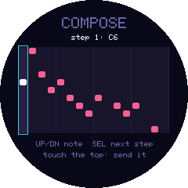

**Games → Compose.** Write a tune, and send it to the badges around you.
Sixteen steps loop round, each a rest or one of eleven notes of A minor
pentatonic over two octaves — a scale where every note sounds right with
every other, so anything you write is a tune. It plays while you write.

| Button | Does |
| --- | --- |
| **UP / DOWN** | The note on this step, higher or lower |
| **SELECT** | On to the next step |
| **Touch the top** | Send it to every badge nearby with Compose open |
| **Hold SELECT** | Back. Your tune is kept |

A tune sent to you plays straight away, with who sent it. **SELECT** while it
plays keeps it in place of yours; leave it and yours comes back after a few
seconds. The ring shows the sixteen steps around it, the playing one lit.
**Settings → Sound** has to be on; ALL and EFFECTS both play it.

## Morse

**Games → Morse.** Learn Morse code, then chat in it across the room. The
**key** is the TAG pad on the top of the badge, or the DOWN button: hold it for
as long as the sound should last. A short press is a dit (·), a long one a dah
(–). The badge sounds a tone while it's down, and the ring - and an SAO from
the set - flashes with it.

| Button | Does |
| --- | --- |
| **TAG pad / DOWN** | The key |
| **UP** | In LEARN, the speed: 5, 8, 10, 13, 15 or 20 words a minute. In CHAT, a phrase to send |
| **SELECT** | Switch between **LEARN** and **CHAT**; with a phrase showing, send it |
| **Hold SELECT** | Back. Your progress and speed are kept |

**LEARN** teaches the way radio clubs do, by the Koch method: you start with
just two letters, **K** and **M**, at full speed. The badge sends one, and you
key it back. Get nine in ten of the last twenty right and the next letter
joins in: the badge shows it, spells it out and plays it a few times first.
There are forty in all - the alphabet, the figures and a few signs - and the
ring fills up as you go. The letters themselves play at your speed, with the
gaps between them stretched out, so you learn each one by its sound rather
than by counting.

**CHAT** reads your keying as you go and writes it on the screen. Every letter
you finish is sent to every badge nearby with Morse open, where it plays in
your rhythm and scrolls up with your name; theirs come to you the same way.
The badge learns your hand as you key, so a slow or uneven rhythm still reads.
A pause of about three dits ends a letter, and seven ends a word.

**Phrases**, for when you'd rather not key it all, or don't know the code
yet: in CHAT, **UP** shows one at the bottom of the screen and UP again the
next, and **SELECT** sends it, played and sent letter by letter as if you'd
keyed it. They are the radio shorthand - **CQ CQ DE** *your name* (calling
anyone), **DE** *your name* (this is me), **QSL** (got it), **TNX** (thanks),
**73** (best wishes), **88** (love and kisses), **WHERE R U?** and **SOS** -
and two for the con, **HACK THE PLANET** and **DC35**. Leave it a few seconds
and the picker goes away.

The tone comes from the piezo, so **Settings → Sound** has to be on to hear
it; the screen and the ring work either way. Over USB serial, `MORSE` says
how far you've got, `MORSE KEY .- -...` keys for you, and `MORSE SAY <text>`
sends whatever you type to the badges around you.

## Fox hunt

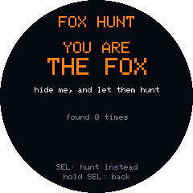

**Games → Fox hunt.** The radio-club game. One badge becomes **the fox** and
is hidden - in a bag, behind a plant, on a person - and calls out to the
badges around it a couple of times a second. Everyone else with Fox hunt open
is a **hunter**: their badge hears the fox, and how strongly, and turns that
into hot and cold. The ring fills and reddens and the ticks speed up as you
close in; the screen says WARMER or COLDER as you go. Get right up to it -
about a hand's width - and touch **TAG** to catch it. The fox's badge hears
who caught it, and keeps the list.

| Button | Does |
| --- | --- |
| **SELECT** | Become the fox, or go back to hunting |
| **UP** | With several foxes about, which one to chase |
| **TAG / DOWN** | Catch it, once you're close enough |
| **Hold SELECT** | Back to the menu |

Signal strength is a rough guide, which is the fun of it: bodies, walls and
the way the badge is held all change it, so it's warmer/colder, not a map.
Over USB serial, `FOX` says what this badge hears.

## Spin the bottle

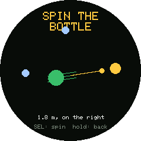


**Games → Spin the bottle.** Lay the badge in the middle of a table, or stand
it up facing a group, and press **SELECT** (or touch TAG): a bright neck races
round the ring, slows, and stops pointing at somebody - always a real person
the radar has seen, never an empty chair. The screen draws the bottle and the
people round it, and says how far away the pick is and on which side. What
happens next is up to the table.

The radar only sees people who move, so it remembers everyone it has seen in
the last few seconds: a fidget or a reach for a drink is enough to be in. It
never picks the same person twice running if there's anyone else. If it says
**nobody seen**, everyone wave. Over USB serial, `SPIN` spins it.

## Tic-tac-toe

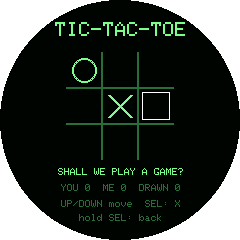

**Games → Tic-tac-toe.** A nod to *WarGames* (1983). You play X against a
computer that plays perfectly, so the best you can do is a draw - you go first,
which is the only edge you get. **UP** and **DOWN** move between the free
squares and **SELECT** plays your X. Draw often enough and it starts to learn,
the way the film's computer did; play on and see what it concludes.

## Neon trails

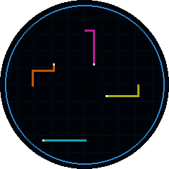

**Games → Neon trails.** Four riders, each leaving a wall of light behind it,
and none of them can stop. Run into any trail - your own included - or the
edge of the arena and you're out; the last rider moving wins. You're cyan, the
other three are the badge's, and they look before they turn. The pace picks
up as the round goes on.

| Button | Does |
| --- | --- |
| **UP / DOWN** | Turn left / right, from where you're heading |
| **SELECT** | Start a round |
| **Hold SELECT** | Back to the menu, between rounds |

A quick double press is kept, so two turns land on two steps running: that's
how to pull a U-turn in a tight spot.

## Outbreak

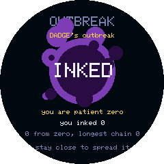

**Games → Outbreak.** A con-wide infection game. A few badges start out as
**patient zero**. An inked badge puffs ink at the badges around it, and a
clean badge that stays close to an inked one for a few seconds is inked too —
and passes it on. Nobody gets cured; it's ink.

It spreads whenever two badges both have the badge-to-badge radio up:
**Outbreak, Swarm, the pet squid and Compose all carry it.** The screen says
whether you're inked, whose outbreak it is, who inked you, how many badges
you've inked yourself, and how long the longest chain has grown. A clean
badge flashes purple, ring and screen, while someone is inking it.

The first time a badge opens Outbreak it has a one-in-twelve chance of being a
patient zero. Over USB serial, `INK` says how it stands, and `INK ZERO` makes
a clean badge a patient zero — for whoever is running the con.

## Squoricle

**Serial console → ASK.** Plug the badge into a computer, open its serial
console and type `ASK` and a question. The Squoricle, a very old squid, answers. Every word
of the answer is written, a character at a time, by a small AI — two neural
networks — running on the badge's own **ESP32**, the same microcontroller
that reads the radar and drives the ring. No network, no server, no cloud:
unplug the Wi-Fi and it answers just the same.

```
ASK will i win the ctf
The Squoricle says: The password is not password. It is close, though.
[oracle] topic hacking (100% sure), about "ctf"; 50 chars; 386 ms to read
ASK should i buy bitcoin
The Squoricle says: Your wallet is light, but your heart glows.
[oracle] topic money (100% sure), about "bitcoin"; 43 chars; 386 ms to read
```

| | |
| --- | --- |
| **Getting there** | Any terminal at 115200 baud — on Windows the flash kit's `flash\console.cmd` is easiest. How to open one on every system is under **CTF → Serial console** |
| **Asking** | `ASK`, a space, and up to 60 characters. Capitals, punctuation and the question mark don't matter. Ask the same thing twice and you get two different answers: it rolls the dice on every letter |
| **What it knows** | Sixteen moods: yes-or-no, love, money, hacking, code, sleep, food, the con, security, work, the future, luck, friends, being lost and the deep — and a general one for everything else. Now and then it says the key word of your question back to you |
| **AI on a microcontroller** | The ESP32 is a few-dollar chip with 520 KB of memory, running at 240 MHz — no graphics card, no accelerator, nothing a chatbot would recognise as a computer. The oracle fits anyway: its weights take about 170 KB of the firmware, and it thinks in under 6 KB of memory. It was trained on a PC with PyTorch, then squeezed to 8-bit numbers and compiled into the firmware, so the badge only ever runs it. The same idea, scaled down about a million times, as the large language models behind today's chatbots: predict the next character, again and again |
| **How it works** | Two networks. The first reads your question and decides what it's about, from the letters it's made of — so typos and plurals still land — and says how sure it is in the line under the answer. The second, about 145,000 weights stored as 8-bit numbers, writes the answer one character at a time in about a third of a second; the badge then types it out at reading speed, for effect. Everything it says is its own remix of a few hundred lines it was taught |

It's a fortune teller, not an assistant. Nobody said it would be helpful. The
badge's own log messages wait while it talks.

## THE DEEP SIGNAL

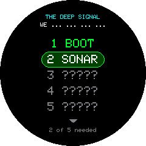

**Quest → Deep Signal.** CompuNet built your badge as a sonar squid: a
listening drone. In testing, the drones heard something in the deep answer
back. Yours woke up with its memory scrambled. Put it back together.

**Five chapters,** each a handful of things to do somewhere on the badge.
Finish a chapter and the drone remembers one word of what the deep said; the
words line up at the top of the log as you go. Chapters open in order, but
anything you do counts whenever you do it, even before its chapter opens.

**The log doesn't tell you what to do.** It gives riddles. Each entry shows as
`?????` until you've done it; only then does it get its name. Not every mode
on the badge is in the quest, and a chapter never needs all of its entries:
working out which ones count is the game. Some entries need a second badge;
none of them is ever required.

**Rank.** Your rank rides on the leaderboard beside your score, and on the
phone board: *Plankton*, *Hatchling*, *Squid*, *Giant squid*, and, for those
who answer, *Kraken*. The quest gives rank, not points: the CTF's flags keep
their points, and every flag is part of the story too.

**The answer.** When all five words are back, the log offers **ANSWER**. The
deep asks a question; answer it with what the badge has taught you. It needs
nobody else. Other badges make it bigger, though: every badge yours has heard
answer, on the leaderboard, at any time, anywhere it reached, rises with you.

**After the con** there's an epilogue, *Surfacing*, for the badge at home.

Over USB serial, `QUEST` shows the log (riddles included) and `QUEST RESET`
starts it again.

## CTF

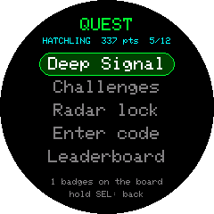

Capture the flag, on the badge, under **Quest**. Eleven challenges, 1050 points between them
— and a twelfth, hidden, worth 137 more — with a **leaderboard that spreads
from badge to badge**: no server, no Wi-Fi. It is for bragging rights.

| Challenge | Points | Hint |
| --- | --- | --- |
| Radar lock | 100 | Three places to stand, found by warmer and colder |
| Serial | 100 | The badge says something at boot that a 115200 terminal can't read |
| SAO Morse | 150 | While the CTF is open, SAO pin 5 is talking. An LED to GND will hear it |
| SAO I²C | 200 | Someone keeps calling on the SAO's I²C bus, and nobody answers. Listen |
| Squid 500 | 50 | Score 500 in Squirt |
| Squoom 300 | 50 | Score 300 in Squoom |
| Duel | 50 | Win a Duel against another badge |
| SAO set | 50 | Build the four SAOs from your kit and plug each one in, one at a time |
| Social butterfly | 50 | Get 25 other badges onto your leaderboard |
| Squidling | 50 | Raise the pet squid until it's grown up |
| The Deep | 200 | Type `DIVE` on the badge's serial console. Bring all four SAOs |
| ????? | 137 | A code older than most players here. This badge has no left or right |

The same hints are on the badge, under **Challenges**. A captured flag turns
green — and the hidden one shows its name once it's yours.

**How flags are captured.** Some are automatic: the badge sees you open the
radar lock, reach a score, win a Duel, plug in the last of your four SAOs,
have 25 other badges on your leaderboard, or raise your pet squid.
The rest end in an 8-character
**code** — letters and digits, with no I, O, 0 or 1 to misread. Enter it under
**Enter code**: UP and DOWN change the letter, SELECT moves on, and holding
SELECT tries it. Over a USB serial connection, `FLAG <code>` does the same.

**The serial console.** Plug the badge into a computer with a data cable and
open a terminal on its port at **115200 baud**. The port is `COM3` or similar
on Windows (Device Manager → Ports), `/dev/cu.usbserial-…` on a Mac, and
`/dev/ttyUSB0` on Linux.

On Windows the easiest is the flash kit's console, with nothing to install:
download the [updates repository](https://github.com/slash128v6/DC35_Cnet_Badge-updates)
(**Code → Download ZIP**), unzip it, and double-click `flash\console.cmd`. It
finds the badge by itself and restarts it as it connects; **Ctrl+]** quits.
Otherwise, swap your port into whichever of these suits you:

```
python -m pip install pyserial                # once, for the line below
python -m serial.tools.miniterm COM7 115200   # any OS; Ctrl-] quits
putty -serial COM7 -sercfg 115200,8,n,1,N     # Windows, with PuTTY
screen /dev/cu.usbserial-0001 115200          # Mac or Linux; Ctrl-A then K quits
```

The Arduino IDE's Serial Monitor works too: 115200 baud, and type into its
message box. Whatever you type is echoed back, and Enter sends the line.
`HELP` lists the badge's commands. The installer's console in the browser only
shows what the badge prints; you can't type into it.

**The Deep.** A text adventure on the badge's serial console, played with your
four SAOs. Open the serial console and type `DIVE`. You explore a reef and the
wreck of an old cable ship, and four places are locked to the four SAO shapes:
when something won't give, think about its shape, plug that SAO into your
badge, and try again. Each one tells you where its shape goes in the vault at
the bottom of the trench, which opens when it's shown all four SAOs in the
right order — different on every badge. Inside is your code for the flag.
`HELP` lists the words that work. The badge's own log messages are silenced
while you dive; `SURFACE` gives the console back, and your progress is kept
for next time.

**Codes are different on every badge.** Telling a friend yours won't help them.
Taking the firmware apart to work out how codes are made is fair game — it's a
hacking con.

**The radar lock.** Stand the badge up facing the room, open **Radar lock**,
and walk out in front of it. The ring shows where the radar sees you: blue is
cold, red is hot, and in the right place it turns green and fills. Stay there
about three seconds and it clicks; three places open it. The screen faces the
other way, so this is a game for the ring and someone in front of it.

**The leaderboard.** While the CTF is open, the badge swaps scores with any
other badge that has the CTF open nearby, and passes on what it has heard, so
the board builds up as people cross paths over the day. **Leaderboard** shows
it ranked, with your row in green and each badge's SAO team as a small shape
before its name. SELECT there shows **Teams**: every team's points added up,
best first, and how many badges are on each. It is kept when the badge is
switched off. It shares only your badge name, score and team, never anything
that identifies the badge itself.

**On your phone.** SELECT on Teams shows **SCAN ME**, a QR code of your
badge's row. A phone camera opens the **CTF board** on the badge website,
which keeps every badge that phone has scanned and ranks them, teams and all.
No app and no account. The scores travel in the link after the `#`, which a
browser never sends to the website, and the board stays on the phone. After
one visit it works offline too. SELECT again goes back to the badges.

A badge drops entries it can't make sense of, such as flags that didn't exist
in its firmware or teams from before it had them. So badges on older
firmware leave newer ones off their board until they update themselves.
Newer badges list the older ones, without a team.

While the CTF is open the badge doesn't check for updates (the radio is busy
with the leaderboard), and it drives SAO pin 5 and the SAO's I²C pins —
take off an add-on that uses them first.

---

## Settings

**Set name.** Up to 8 characters: A–Z, 0–9, space and dash. UP/DOWN change the
letter, SELECT moves to the next one, and **hold SELECT to finish — it always
saves**. The name appears in the menu, in Bling mode, and as the device name
in Home Assistant. An empty name becomes `BADGE`.

**Wi-Fi setup.** Asks to confirm, then forgets the saved network and opens the
setup page, where you enter the network the badge should join. The same page
carries the optional MQTT details for Home Assistant mode, an **Update URL**
box — leave that blank, which means "use the built-in one" — and the same
**Automatic updates** and **Start up in** choices as the Settings rows below — so a
badge can be set up and told to come up as a presence sensor in one go — and
the **Time zone** for the ring clock. The URL box exists so a badge can be
pointed at a different update server without being reflashed.

**Sound: ALL / EFFECTS / OFF.** Press SELECT to step through the three.
*ALL* is everything: the effects, and the background music in Squirt and
Squoom. *EFFECTS* keeps the effects and drops the music. *OFF* is silent — for a talk.
The choice is remembered. Sound needs a piezo: rev G boards have one built in,
and on rev F one is added by hand to the Dev Module's D32 pin; without one this
setting does nothing either way. With one fitted: Squirt has effects for
the jet, ink, pearls, hits and the rest; Sneak calls "go", warns when it is
about to turn, and buzzes a catch; Duel ticks, says go, and plays you a win or
a loss; Boss mode rings a soft doorbell when someone walks up; the menu clicks;
and the two games have their music, played only while a game is on and
speeding up as it gets harder.

**Start: MENU / BOSS / SNEAK / BLING / HASS / CLOCK.** Which mode the badge
comes up in when it is switched on. Press SELECT to step through the six and
wrap round; the row shows the current one, and it survives a power cycle and a
firmware update.

*MENU* is the default and shows the menu, as before. The others skip it: a
badge set to *HASS* goes straight back to being a presence sensor after a power
cut, which is the point — nobody wants to walk over and press buttons to get
their Home Assistant sensor back. *BLING* is the one to pick for wearing the badge around; *BOSS* and *CLOCK* for
leaving it on a desk.

Holding SELECT or pressing BOOT still gets you back to the menu from any of
them, so this cannot lock you out of anything.

Two things it deliberately does not do. **Duel is not on the list**, because
Duel takes the radio for talking to the other badge and a badge that booted
into it would never check for updates. And **HASS falls back to the menu when
no Wi-Fi is stored** — otherwise a badge that had been reset would come up in
the setup page instead of anything recognisable.

**Updates.** Opens a small list of its own:

- **Check now** looks for new firmware straight away instead of waiting for the
  next automatic check, whatever the next row says. See **Updates** below.
- **Automatic: ON / OFF** is whether the badge looks for new firmware by
  itself. Press SELECT to switch; the choice survives a power cycle and a
  firmware update. *ON* is the default and the one to leave alone: the badge
  checks every ten minutes or so and installs what it finds. *OFF* stops it
  checking — and, with no other reason to use the network, stops it switching the
  Wi-Fi radio on at all. Updates still work, you just ask for them with
  **Check now**. Choose this if you want to know exactly which firmware is on
  the badge during a talk or a demo, or would rather it stayed off the network
  you are on.

The firmware version the badge is running is shown at the top of Settings and
of Updates.

**Reset.** Asks to confirm, then wipes the name, Wi-Fi, MQTT and Bling settings
and restarts. Do this before giving the badge to someone else — settings
survive firmware updates, so otherwise your network goes with it.

---

## Badge console

The badge website has a **Badge console**, at
[slash128v6.github.io/DC35_Cnet_Badge-updates/console.html](https://slash128v6.github.io/DC35_Cnet_Badge-updates/console.html).
Plug the badge into a computer with a USB-C data cable, open that page in
**Chrome or Edge**, and press **Connect**. No install; the page talks to the badge over the cable and
nothing leaves the computer. From there you can:

- **See the screen** and **press the buttons** — click them, or use the arrow
  keys, Enter and Backspace — and jump straight to any mode.
- **Set the badge's name and contact card**, and its **Wi-Fi** without the
  setup page (the password goes down the cable and nowhere else).
- **Read your CTF flags and the badge's leaderboard**, enter a flag code, and
  add the badge to the CTF board in that browser.
- **Type commands** at the serial console, as with any terminal at 115200.

Firefox, Safari and phones can't talk to USB serial ports, so it's a computer
thing. The phone's way in is the **CTF board** (see **CTF**).

## Updates

The badge can update its own firmware over Wi-Fi. It needs a network set up
first (**Settings → Wi-Fi setup**); without one it never looks.

It checks shortly after starting up and then about every ten minutes, and you
can ask it to look straight away with **Settings → Updates → Check now**. To stop
it checking on its own, set **Automatic** there to *OFF*; **Check now** still
works, so that means "ask me" rather than "never". When it
finds something newer it downloads it, shows progress on the screen, and
restarts into the new version. The version it is running is at the top of the
Settings screen, so you can tell at a glance whether an update arrived.

**Nothing you have set is lost.** The name, the Wi-Fi details and the Bling
settings all survive an update. Only **Reset** clears those.

**It will not install firmware from anyone else.** Every update is signed, and
the badge checks the signature against a key built into it before writing
anything. An update that is not signed with that key is refused, so being on a
strange Wi-Fi network does not let someone push their own firmware to your
badge. It also checks the downloaded file against a fingerprint in the signed
update notice, so a file that arrives damaged or altered is thrown away rather
than installed.

### When it can't update itself: install by USB

A badge on firmware **1.0.20 or older** looks for updates at an address that
no longer serves them; a badge with no Wi-Fi never looks; and one that won't
start can't. All three take one install over a USB cable, and then update over
Wi-Fi again. Your name, Wi-Fi details, settings, scores and CTF progress are
kept unless you choose to erase.

1. **From your browser — the easy way.** Open
   [Flash from your browser](https://slash128v6.github.io/DC35_Cnet_Badge-updates/install.html) in **Chrome or
   Edge** on a computer, plug the badge in with a data cable, and click
   **Connect and install**. The page checks the release's signature first,
   exactly as the badge would, and installs nothing it can't verify. Leave
   **Erase device** unticked to keep your settings.
2. **With the cable kit — for other browsers, or no browser.** Download the
   [updates repository](https://github.com/slash128v6/DC35_Cnet_Badge-updates)
   (**Code → Download ZIP**) and unzip it. If you don't have the Arduino IDE
   or Python, get Espressif's standalone esptool: from
   [esptool's releases page](https://github.com/espressif/esptool/releases) download
   `esptool-v…-windows-amd64.zip` and unzip it into the kit's `flash` folder.
   Then double-click `flash\flash.cmd`. The
   [kit's instructions](https://github.com/slash128v6/DC35_Cnet_Badge-updates/blob/main/flash/README.md) cover macOS and Linux too.

**No badge in the list, or no COM port?** The computer needs the driver for
the board's USB chip — a **Silicon Labs CP210x** on these badges, a **CH340**
on some other ESP32 boards. On Windows, open **Device Manager**: the badge
should be under **Ports (COM & LPT)**. If it isn't, or shows under **Other
devices** with a warning sign, install the **CP210x Universal Windows Driver**
from [Silicon Labs](https://www.silabs.com/developers/usb-to-uart-bridge-vcp-drivers) (or
[CH341SER](https://www.wch-ic.com/downloads/CH341SER_EXE.html) for a CH340 board), then plug the badge in again.
macOS usually needs nothing; Linux never does, though you may need to join the
`dialout` group. And try another cable first: many only carry power.

**A failed update leaves the badge alone.** The new firmware is written to a
spare area, and the badge only switches to it once the whole download has been
checked. If the download fails or the check does not pass, it simply keeps
running what it has. And if a new version turns out to crash in the first half
minute, the badge goes back to the previous one by itself.

**Two things that look wrong and are not:**

- **"Up to date" just after a new version was released.** The update server
  holds its answer for a few minutes, so a badge that asks too early is told
  there is nothing new. Wait a little and check again.
- **No check during a Duel.** A duel uses the radio to talk to the other
  badge, so the badge will not interrupt a game to look for updates. It
  catches up afterwards. The same applies while the setup page is open.

---

## Demo mode

If the badge hears nothing from its radar in the first 3 seconds after
switching on, it shows `NO RADAR - DEMO` and runs Sneak and Boss mode on
simulated people, so you can see how they work. It decides once, at startup:
plug a radar in afterwards and you need to restart. Home Assistant mode never
sends simulated data, and Duel has nothing to simulate — it needs a real
opponent.

`radar idle` in the footer means the radar is connected but hasn't reported
anyone for 20 s — usually just an empty room.

---

## Ring colours at a glance

| Mode | Ring |
| --- | --- |
| Menu | one dim cyan dot creeping round |
| Sneak | see the table under Sneak |
| Duel | see the table under Duel |
| Boss | dim cyan; dim amber breathing on an alert |
| Bling | on FOLLOW, follows people — red and bright up close, cyan and dim further off, rainbow when nobody is there. On the other seven patterns, whatever that pattern does |
| Home Assistant | see the table above |
| Wi-Fi watch | one dim green dot stepping round with the channel; breathing red on an alert |
| SAOs | a quarter per shape collected, in its colour; the plugged-in one pulsing |
| Pet squid | breathing in its colour; sparkles when it eats, grows or wins a game; dim blue asleep |
| Theremin | glowing in the colour of the note, with each player's LED pointing at them |
| Kraken Run | the speedometer, green to red; gold for a pearl, red for a hit; the Kraken's health in the fight |
| Flying squids | a comet circling at the flock's pace; warm toward each person nearby |
| CompuNet | CompuNet blue all round, with a white comet following the brush as it paints |
| Home Assistant, Ring on | whatever colour and effect Home Assistant set |
| DEF CON | each LED in the colour of the art on its side, lighting as each pulse reaches the edge; the logo's heart flickering through |
| Life | a soft blue glow that brightens with each generation's births |
| Swarm | the show, in step with every badge in the swarm |
| Contact card | soft cyan breathing; a spinner while a badge is close enough to swap; green for a card kept |
| Flashlight | all white, or all red |
| Compose | the sixteen steps round the ring, the playing one lit |
| Fox hunt | hunting: fills from the top as you close in, blue to red, green once caught. The fox: a slow orange breath, flashing white when caught |
| Spin the bottle | a dim mark at each person seen; the gold neck spins and stops on one, flashing |
| Speed gun | a speedometer from the top, green to red; flashing gold on a record |
| Blue box | the tones being played, as points round the ring |
| Tic-tac-toe | a quiet green; flashing green, red or gold for a win, a loss or a draw |
| Neon trails | a quarter per rider, lit while it's still going; a white flash at each crash |
| Morse | flashing with the key: cyan for yours, gold for the badge's, pink for another badge's; in LEARN, how many letters you have, green or red for each answer |
| Outbreak | soft green while clean, a slow purple swirl once inked, flashing purple while being inked |

---

## Troubleshooting

| Problem | Try |
| --- | --- |
| A mode shows **Making room...** and the badge restarts | Normal, now and then: a full-screen mode couldn't get the memory it needs in one piece, so the badge restarted straight back into it. If it ever shows **Out of memory** instead, switch the badge off and on. |
| Can't see the `-setup` network on my phone | Wait 10 s, or leave and re-enter Home Assistant mode. It drops briefly while scanning — pressing Rescan causes that. Stand within a few metres. |
| Setup page won't load | Make sure the phone is still on the badge's network (phones often hop back to their usual Wi-Fi), then open `http://192.168.4.1` — plain `http`. |
| My network isn't in the list | It must be 2.4 GHz. Press Rescan, or type the name in the hidden-network box. |
| Stuck on `Wi-Fi...` | Check the password, use a stronger USB supply, and move nearer an access point. |
| Stuck on `MQTT...` or `failed` | Check the broker IP, port, username and password, and that the broker allows the connection. |
| Occupancy stays on after I leave | Expected for 60 s after the last movement. |
| Duel says `no other badge yet` | Both badges must be in Duel mode, and within radio range. A badge in Home Assistant mode can't also be duelling. |
| Duel never calls anyone out | Point each badge at the *other player*, not at yourself, and stand within about 5 m of each other. |
| The touch pad does nothing | It only works in Sneak, Duel and Boss — by design. If it's dead there too, check nothing conductive is taped across the mantle. |
| Screen is upside down | Hold BOOT for about a second. |
| `NO RADAR - DEMO` with a radar fitted | Check the radar's pigtail and power, then restart. |
| Sneak won't let me quit with SELECT | That's on purpose mid-round. Press BOOT. |
| No battery percentage on screen | Expected. This board has no battery gauge. |
| Says `Up to date` but I know there's a new version | The update server holds its answer for a few minutes. Wait, then **Check now** again. |
| Update never happens on its own | Check **Settings → Updates → Automatic** says *ON*. It also needs Wi-Fi set up, and it will not interrupt a Duel or the setup page. |
| I want the badge to stay off the network | Set **Settings → Updates → Automatic** to *OFF*. With no Home Assistant mode running, the badge then never switches the radio on by itself. |
| Set it to start in HASS, but it shows the menu | It needs Wi-Fi stored to start there, and falls back to the menu when there is none — after a **Reset**, for instance. Set Wi-Fi up again. |
| Starts in a mode and I want the menu back | Hold SELECT, or press BOOT. To change it for good, **Settings → Start** until it says *MENU*. |
| Screen is speckled or garbled in every mode | The screen is running faster than this badge's wiring can carry. Hold **UP and DOWN together** while switching on: that sets the safe 20 MHz. |
| Clock says `clock not set yet` | It has not been online since it was switched on. Set Wi-Fi up, or use **Updates → Check now** to put the radio on briefly. |
| Clock is out by whole hours | No time zone set, so it is showing UTC — and saying so, in amber, under the time or in the date window. Set one on the setup page. |
| No sound at all | Rev F boards have no piezo; one has to be added to the D32 pin by hand. With one fitted, check **Settings → Sound** is not *OFF*. |
| The alarm did not go off | It has to be **on** (amber dot on the dial), and the clock has to be set — the alarm screen says if it is not. With Sound off it only flashes. |
| The CTF leaderboard only shows me | Other badges have to have the CTF open too, and be within a few tens of metres. The board builds up as you pass people. |
| Clock is out by a few minutes | It has been off the network a while; the chip's crystal drifts. It corrects itself at the next sync. |
| `Bad signature` when updating | Nothing was installed and the badge is unharmed. In the few minutes after a new release this is usually the update server part-way through switching over: wait five minutes and check again. If it persists, the badge has refused firmware that was not signed for it, which is it working as designed. |
| Always `Up to date`, but a newer version is out | Check **Settings → Updates → Automatic** says *ON*, or pick **Check now**. A badge on firmware **1.0.20 or older** looks for updates at an address that no longer serves them and needs one update by USB — see [install by USB](#when-it-cant-update-itself-install-by-usb). After that it updates over Wi-Fi again. |
| Bling ring lights but never moves | It should follow you. If it sits still, the radar is not being read — restart the badge, and check the radar pigtail if `NO RADAR` appears. |

---

## Specifications

| | |
| --- | --- |
| Controller | ESP32 Dev Module, 30-pin, USB-C (ESP32-WROOM-32) |
| Display | 1.28" round 240 × 240 GC9A01, SPI |
| Radar | Ai-Thinker RD-03D, 24 GHz, tracks up to 3 people, ±60° wide, about 6 m in play |
| Ring | 24 × WS2812B, current-limited in firmware |
| Buttons | UP, DOWN, SELECT, plus BOOT on the Dev Module |
| Touch | 34 × 14 mm mantle pad, marked with a bullseye; live in Sneak, Duel and Boss |
| Wireless | Wi-Fi 2.4 GHz for Home Assistant; ESP-NOW for Duel. One at a time. |
| Expansion | SAO v1.69bis-style 2 × 3 header at the mantle tip |
| Lanyard | 2 × 5 mm holes, one per fin |
| Power | USB-C. No battery gauge on this board. |
